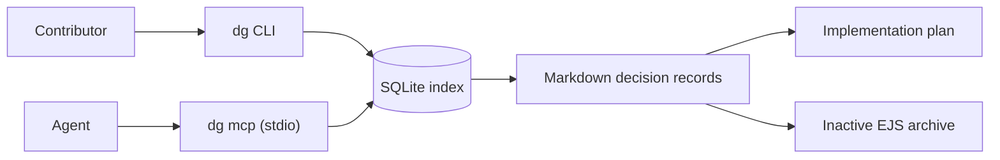

# decision-graph (`dg`)

decision-graph is a Node.js tool for indexing architecture decision records
(ADRs) and session decision records (SDRs) so developers and coding agents can
find applicable decisions. The CLI supports initializing a project, importing
and syncing records, creating ADR drafts, querying the local decision graph,
and exposing those workflows to agents through an MCP stdio server.

## Table of Contents

- [About](#about)
- [Features](#features)
- [Tech Stack](#tech-stack)
- [Architecture](#architecture)
- [Project Structure](#project-structure)
- [Getting Started](#getting-started)
- [Configuration](#configuration)
- [MCP clients](docs/mcp.md)
- [Security](#security)
- [How to Contribute](#how-to-contribute)
- [What's Next](#whats-next)
- [License](#license)
- [Acknowledgements](#acknowledgements)
- [Author](#author)

## About

This repository is transitioning from the Engineering Journey System (EJS),
which recorded whole agent sessions, to decision-graph, which is intended to
make durable decisions and their rules easier to search and apply. The local
CLI, SQLite index, record formats, and MCP stdio server are implemented.
Multi-project remote storage remains planned.

See the [implementation plan](docs/IMPLEMENTATION-PLAN.md) for planned scope
and progress, the [user guide](docs/user-guide.md) for the repository's current
workflow, and the [administrator guide](docs/admin-guide.md) for its current
operational status.

## Features

| Capability | Status |
|---|---|
| CLI decision indexing, queries, SDR capture, lint, verification, and graph export | Implemented |
| MCP stdio server (`search`, `context`, `get`, `related`, `list`, `sdr_add`, `lint`) | Implemented |
| Agent instructions compiled into `AGENTS.md` | Implemented |
| Multi-project server and remote storage | Planned; not implemented |
| EJS historical material | Preserved in [`legacy/`](legacy/README.md); inactive and not maintained as runtime tooling |

## Tech Stack

The package requires Node.js 26 or newer and uses TypeScript, Commander, the
Model Context Protocol SDK, and SQLite via `better-sqlite3`. Postgres and the
multi-project server remain planned.

## Architecture

The local runtime consists of a CLI and stdio MCP server backed by a SQLite
index. Markdown decision records remain the source of truth; the SQLite
database is a rebuildable index. The EJS materials are isolated under
`legacy/`.



The planned decision-graph architecture is described in the
[implementation plan](docs/IMPLEMENTATION-PLAN.md). No decision-graph ADRs have
been adopted yet; see the [ADR index](docs/adr/README.md).

## Project Structure

- `src/cli/` — The `dg` CLI entry point and command program.
- `test/` — CLI scaffold tests.
- `docs/` — Current implementation plan and project guides.
- `legacy/` — Inactive historical EJS files; do not run its hooks, skills, or scripts.
- `package.json` and TypeScript/tool configuration — Package scripts and development toolchain.
- `.github/copilot-instructions.md` — Points contributors to the implementation plan.
- `.gitignore` — Git ignore rules for the repository.
- `LICENSE` — MIT license.

## Getting Started

Build the CLI from source to use its decision-management and MCP commands.

Prerequisites: Git and Node.js 26 or newer with npm.

```sh
git clone https://github.com/McFuzzySquirrel/Engineering-Journey-System.git
cd Engineering-Journey-System
npm ci
npm run build
node dist/cli.js --help
```

Use `node dist/cli.js --help` to list commands. For MCP client setup, see the
[MCP configuration guide](docs/mcp.md). Contributors can run `npm run lint`,
`npm run format:check`, `npm run typecheck`, and `npm test`. The package is not
published to npm yet.

## Configuration

`dg init` creates project configuration in `.dg/config.json` and a local
`.dg/graph.db` index. MCP clients launch `dg mcp` in the project directory; see
the [MCP configuration guide](docs/mcp.md). `DG_TEST_PG_URL` is reserved for
the planned Postgres implementation.

## Security

The MCP server runs as a local stdio subprocess and accesses the current
project's Markdown records and SQLite index. It does not bind a network port or
handle credentials.
Do not put credentials or other secrets in tracked files. For a suspected
vulnerability, avoid posting sensitive exploit details publicly; use GitHub's
private vulnerability reporting if it is enabled for this repository. No
separate security policy is currently documented.

## How to Contribute

For changes, open an issue to discuss substantial scope, then submit a pull
request with a focused diff and a description of what changed. Keep unimplemented
behavior clearly labeled as planned, follow the phase acceptance criteria in the
[implementation plan](docs/IMPLEMENTATION-PLAN.md), and do not activate or run
anything under `legacy/`. Review and merge happen through the repository's
GitHub pull-request workflow.

## What's Next

Phases 0-7 are complete. Postgres storage, the multi-project server, and
push/pull remain planned; see the
[implementation plan](docs/IMPLEMENTATION-PLAN.md) for status and acceptance
criteria.

## License

This repository is licensed under the [MIT License](LICENSE).

## Acknowledgements

The implementation plan cites
[actual.ai's agent-optimized ADR article](https://actual.ai/blog/agent-optimized-adrs)
as design inspiration. The earlier EJS project is preserved as historical
reference in [`legacy/`](legacy/README.md).

## Author

Maintained by [McFuzzySquirrel](https://github.com/McFuzzySquirrel). Use the
[GitHub issue tracker](https://github.com/McFuzzySquirrel/Engineering-Journey-System/issues)
for questions, bug reports, or collaboration.
