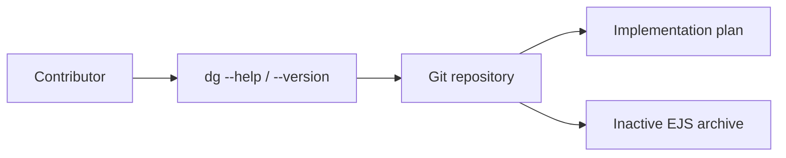

# decision-graph (`dg`)

decision-graph is a Node.js tool for indexing architecture decision records
(ADRs) and session decision records (SDRs) so developers and coding agents can
find applicable decisions. The Phase 1 CLI scaffold is implemented; currently,
`dg` only supports `--help` and `--version`.

## Table of Contents

- [About](#about)
- [Features](#features)
- [Tech Stack](#tech-stack)
- [Architecture](#architecture)
- [Project Structure](#project-structure)
- [Getting Started](#getting-started)
- [Configuration](#configuration)
- [Security](#security)
- [How to Contribute](#how-to-contribute)
- [What's Next](#whats-next)
- [License](#license)
- [Acknowledgements](#acknowledgements)
- [Author](#author)

## About

This repository is transitioning from the Engineering Journey System (EJS),
which recorded whole agent sessions, to decision-graph, which is intended to
make durable decisions and their rules easier to search and apply. The current repository contains the CLI scaffold, its implementation plan, and
an inactive EJS archive. Decision indexing and other product workflows remain
planned.

See the [implementation plan](docs/IMPLEMENTATION-PLAN.md) for planned scope
and progress, the [user guide](docs/user-guide.md) for the repository's current
workflow, and the [administrator guide](docs/admin-guide.md) for its current
operational status.

## Features

| Capability | Status |
|---|---|
| CLI scaffold (`dg --help`, `dg --version`) | Implemented |
| Decision indexing and search | Planned; not implemented |
| ADR and SDR formats and relationship graph | Planned; not implemented |
| Agent access through CLI, MCP, or generated instructions | Planned; not implemented |
| Multi-project server and remote storage | Planned; not implemented |
| EJS historical material | Preserved in [`legacy/`](legacy/README.md); inactive and not maintained as runtime tooling |

## Tech Stack

The CLI scaffold uses Node.js 20.19+, 22.13+, or 24+, TypeScript, and Commander.
SQLite, Postgres, record parsing, and the remaining application capabilities
are planned; they are not implemented yet.

## Architecture

The current runtime is a small Node.js CLI scaffold. Its application
architecture and data stores are not implemented yet; the EJS materials are
isolated under `legacy/`.



The planned decision-graph architecture is described in the
[implementation plan](docs/IMPLEMENTATION-PLAN.md). No decision-graph ADRs have
been adopted yet; see the [ADR index](docs/adr/README.md).

## Project Structure

- `src/cli/` — The `dg` CLI entry point and command program.
- `test/` — CLI scaffold tests.
- `docs/` — Current implementation plan and project guides.
- `legacy/` — Inactive historical EJS files; do not run its hooks, skills, or scripts.
- `package.json` and TypeScript/tool configuration — Package scripts and development toolchain.
- `.github/copilot-instructions.md` — Points contributors to the implementation plan.
- `.gitignore` — Git ignore rules for the repository.
- `LICENSE` — MIT license.

## Getting Started

The `dg` CLI scaffold can be built from source. Only `--help` and `--version`
are implemented; decision-management commands are not available yet.

Prerequisites: Git and Node.js 20.19+, 22.13+, or 24+ with npm.

```sh
git clone https://github.com/McFuzzySquirrel/Engineering-Journey-System.git
cd Engineering-Journey-System
npm ci
npm run build
node dist/cli.js --help
```

Use `node dist/cli.js --version` to print the package version. Contributors can
run `npm run lint`, `npm run format:check`, `npm run typecheck`, and `npm test`.
The package is not published to npm yet.

## Configuration

The CLI scaffold has no runtime configuration or environment variables. The
`.dg/config.json` format and `DG_TEST_PG_URL` mentioned in the implementation
plan are planned features, not supported settings today.

## Security

The CLI scaffold does not run a service or handle credentials, and has no
application authentication or authorization model.
Do not put credentials or other secrets in tracked files. For a suspected
vulnerability, avoid posting sensitive exploit details publicly; use GitHub's
private vulnerability reporting if it is enabled for this repository. No
separate security policy is currently documented.

## How to Contribute

For changes, open an issue to discuss substantial scope, then submit a pull
request with a focused diff and a description of what changed. Keep unimplemented
behavior clearly labeled as planned, follow the phase acceptance criteria in the
[implementation plan](docs/IMPLEMENTATION-PLAN.md), and do not activate or run
anything under `legacy/`. Review and merge happen through the repository's
GitHub pull-request workflow.

## What's Next

The Phase 1 package scaffold is complete. Later phases cover record parsing and
storage, decision-management commands, SDR workflows, generated agent
instructions, verification and linting, MCP, and optional remote storage. None
of these features should be treated as shipped; see the
[implementation plan](docs/IMPLEMENTATION-PLAN.md) for status and acceptance
criteria.

## License

This repository is licensed under the [MIT License](LICENSE).

## Acknowledgements

The implementation plan cites
[actual.ai's agent-optimized ADR article](https://actual.ai/blog/agent-optimized-adrs)
as design inspiration. The earlier EJS project is preserved as historical
reference in [`legacy/`](legacy/README.md).

## Author

Maintained by [McFuzzySquirrel](https://github.com/McFuzzySquirrel). Use the
[GitHub issue tracker](https://github.com/McFuzzySquirrel/Engineering-Journey-System/issues)
for questions, bug reports, or collaboration.
