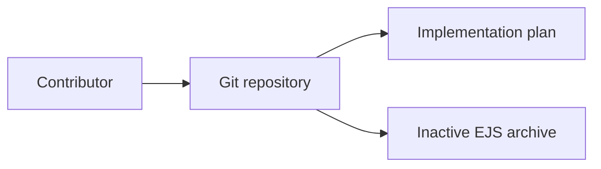

# decision-graph (`dg`)

decision-graph is a planned tool for indexing architecture decision records
(ADRs) and session decision records (SDRs) so developers and coding agents can
find applicable decisions. **The CLI is not implemented or published yet.**

## Table of Contents

- [About](#about)
- [Features](#features)
- [Tech Stack](#tech-stack)
- [Architecture](#architecture)
- [Project Structure](#project-structure)
- [Getting Started](#getting-started)
- [Configuration](#configuration)
- [Security](#security)
- [How to Contribute](#how-to-contribute)
- [What's Next](#whats-next)
- [License](#license)
- [Acknowledgements](#acknowledgements)
- [Author](#author)

## About

This repository is transitioning from the Engineering Journey System (EJS),
which recorded whole agent sessions, to decision-graph, which is intended to
make durable decisions and their rules easier to search and apply. The current
repository contains the implementation plan and an inactive EJS archive; it
does not contain a runnable decision-graph application.

See the [implementation plan](docs/IMPLEMENTATION-PLAN.md) for planned scope
and progress, the [user guide](docs/user-guide.md) for the repository's current
workflow, and the [administrator guide](docs/admin-guide.md) for its current
operational status.

## Features

| Capability | Status |
|---|---|
| Decision-graph CLI, indexing, and search | Planned; not implemented |
| ADR and SDR formats and relationship graph | Planned; not implemented |
| Agent access through CLI, MCP, or generated instructions | Planned; not implemented |
| Multi-project server and remote storage | Planned; not implemented |
| EJS historical material | Preserved in [`legacy/`](legacy/README.md); inactive and not maintained as runtime tooling |

## Tech Stack

The active project is currently documentation and Git history; there is no
application runtime or dependency manifest. The implementation plan proposes
Node.js with TypeScript, SQLite, and optional Postgres, but these are planned
choices, not installed or supported components yet.

## Architecture

There is no running application architecture in the current repository. Today,
contributors use Git to review the project documentation and implementation
plan; the EJS materials are isolated under `legacy/`.



The planned decision-graph architecture is described in the
[implementation plan](docs/IMPLEMENTATION-PLAN.md). No decision-graph ADRs have
been adopted yet; see the [ADR index](docs/adr/README.md).

## Project Structure

- `docs/` — Current implementation plan and project guides.
- `legacy/` — Inactive historical EJS files; do not run its hooks, skills, or scripts.
- `.github/copilot-instructions.md` — Points contributors to the implementation plan.
- `.gitignore` — Git ignore rules for the repository.
- `LICENSE` — MIT license.

## Getting Started

The repository can be read and edited now, but there is no CLI to install or
run.

Prerequisite: Git.

```sh
git clone https://github.com/McFuzzySquirrel/Engineering-Journey-System.git
cd Engineering-Journey-System
```

Start with this README and the
[implementation plan](docs/IMPLEMENTATION-PLAN.md). To verify the checkout,
`git status --short` should report the working-tree state. There are no
application build, test, or lint commands in the current repository.

## Configuration

There are no active application configuration files, command-line flags, or
environment variables because the application has not been implemented. The
`.dg/config.json` format and `DG_TEST_PG_URL` mentioned in the implementation
plan are proposed development details only, not supported settings today.

## Security

This repository does not currently run an application or service, and therefore
has no application authentication, authorization, or secret-management model.
Do not put credentials or other secrets in tracked files. For a suspected
vulnerability, avoid posting sensitive exploit details publicly; use GitHub's
private vulnerability reporting if it is enabled for this repository. No
separate security policy is currently documented.

## How to Contribute

There is no `CONTRIBUTING.md` or code/test toolchain yet. For changes, open an
issue to discuss substantial scope, then submit a pull request with a focused
diff and a description of what changed. Keep proposed behavior clearly labeled
as planned, follow the phase acceptance criteria in the
[implementation plan](docs/IMPLEMENTATION-PLAN.md), and do not activate or run
anything under `legacy/`. Review and merge happen through the repository's
GitHub pull-request workflow.

## What's Next

The immediate planned work is the Phase 1 package scaffold. Later phases cover
record parsing and storage, CLI commands, SDR workflows, generated agent
instructions, verification and linting, MCP, and optional remote storage. None
of these features should be treated as shipped; see the
[implementation plan](docs/IMPLEMENTATION-PLAN.md) for status and acceptance
criteria.

## License

This repository is licensed under the [MIT License](LICENSE).

## Acknowledgements

The implementation plan cites
[actual.ai's agent-optimized ADR article](https://actual.ai/blog/agent-optimized-adrs)
as design inspiration. The earlier EJS project is preserved as historical
reference in [`legacy/`](legacy/README.md).

## Author

Maintained by [McFuzzySquirrel](https://github.com/McFuzzySquirrel). Use the
[GitHub issue tracker](https://github.com/McFuzzySquirrel/Engineering-Journey-System/issues)
for questions, bug reports, or collaboration.
