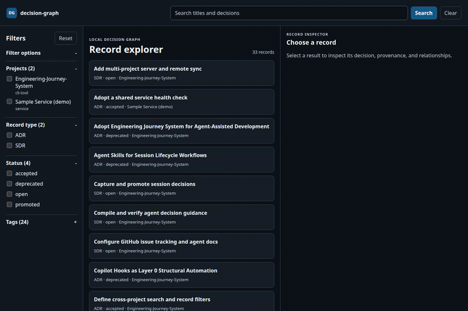
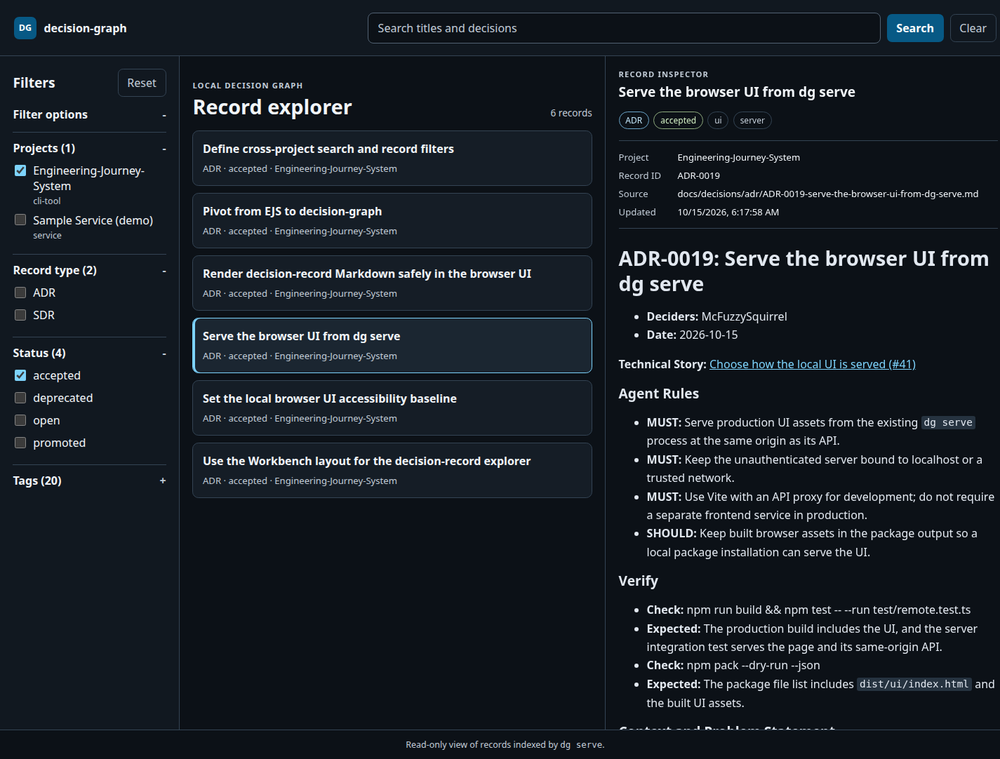
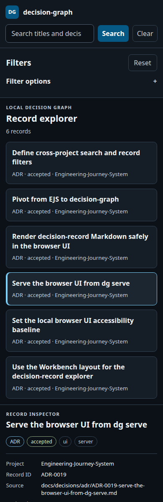
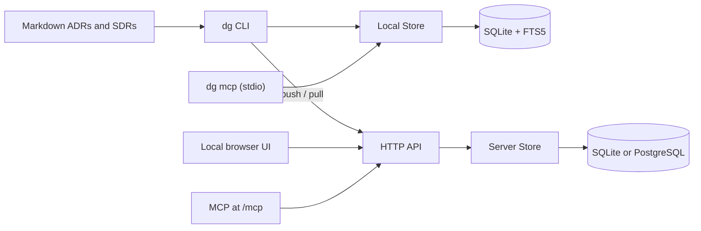

# decision-graph (`dg`)

decision-graph indexes architecture decision records (ADRs) and session
decision records (SDRs) so developers and coding agents can find, scope, and
verify durable decisions. Markdown files are the source of truth; a local
SQLite database is a rebuildable index. The CLI also provides MCP access and
can serve multiple projects over HTTP.

## Table of Contents

- [About](#about)
- [Concepts](#concepts)
- [Features](#features)
- [UI screenshots](#ui-screenshots)
- [Tech Stack](#tech-stack)
- [Architecture](#architecture)
- [Project Structure](#project-structure)
- [Record formats](#record-formats)
- [Getting Started](#getting-started)
- [Quickstart](#quickstart)
- [Command reference](#command-reference)
- [Configuration](#configuration)
- [MCP setup](#mcp-setup)
- [Server setup](#server-setup)
- [Security](#security)
- [Migrating from EJS](#migrating-from-ejs)
- [How to Contribute](#how-to-contribute)
- [Development](#development)
- [What's Next](#whats-next)
- [License](#license)
- [Acknowledgements](#acknowledgements)
- [Author](#author)

## About

The project turns durable engineering decisions into searchable, file-scoped
rules with verification checks and graph relationships. Agents can retrieve
applicable guidance through `dg context`, while teams can query records from
the CLI, an MCP client, or a trusted multi-project server.

The package manifest is `0.1.0`, but it has not been published to npm. The
[changelog](CHANGELOG.md) and [unreleased notes](docs/releases/unreleased.md)
describe current implementation status.

## Concepts

- **ADRs** capture durable decisions, rationale, scoped rules, and checks.
- **SDRs** capture decisions made during work; an SDR can be promoted to a
  proposed ADR.
- **The graph** links records through superseding, relating, derivation,
  promotion, and conflict relationships.
- **`AGENTS.md`** contains a generated managed block with usage guidance and
  accepted rules.

See the [ADR index](docs/decisions/README.md) for active and historical
decision records.

## Features

| Capability | Description |
|---|---|
| Local decision workflow | Initialize, import, sync, search, filter, and relate decision records |
| Scoped agent context | Return accepted ADR rules whose file globs match requested paths |
| Session decisions | Capture SDRs and promote durable decisions to proposed ADRs |
| Validation and export | Lint records, run checks, compile `AGENTS.md`, and export Mermaid or DOT graphs |
| Agent integration | Provide shared tools over stdio MCP and streamable-HTTP MCP |
| Multi-project serving | Store/query projects with SQLite or PostgreSQL and exchange records using push/pull |
| Local browser UI | Browse, search, filter, and follow relationships across indexed projects |

## UI screenshots

The read-only Workbench serves indexed decision records from `dg serve`.
These captures show the desktop and responsive mobile layouts, followed by a
short tour of searching, filtering, and following a record relationship.



The tour uses clearly labeled synthetic Sample Service records to demonstrate
cross-project browsing. The static screenshots show records from this
repository.





## Tech Stack

The CLI is an ESM Node.js and TypeScript application and requires Node.js 26
or newer. It uses Commander, Zod, the Model Context Protocol SDK, SQLite via
`better-sqlite3` with FTS5, and PostgreSQL via `pg`. The HTTP server uses
Node.js HTTP APIs. Vite builds and serves the browser UI in development;
`markdown-it` and DOMPurify render record content safely.

## Architecture

Markdown ADR and SDR files remain canonical. The CLI and local stdio MCP
server use the same Store interface and local SQLite index. The CLI can push
and pull against a remote HTTP server; server MCP requests use the shared
decision tools and a server-side SQLite or PostgreSQL Store.



The [architecture decision records](docs/decisions/README.md) explain
project direction; the [administrator guide](docs/admin-guide.md) describes
server and storage boundaries.

## Project Structure

- `src/cli/` — CLI entry point and command implementations.
- `src/core/` — Schemas, parsers, context, SDRs, and lint logic.
- `src/store/` — Shared Store contract, SQLite/PostgreSQL implementations, and transfer helpers.
- `src/mcp/` — Shared MCP tools and stdio transport.
- `src/server/` — HTTP API and streamable-HTTP MCP transport.
- `src/ui/` — Read-only browser explorer assets.
- `test/` — Unit, CLI, MCP, and optional PostgreSQL integration tests.
- `docs/` — Implementation plan, user/admin/MCP guides, ADRs, and release notes.
- `legacy/` — Inactive historical EJS material; do not execute its hooks or scripts.
- `.dg/config.json` — Project configuration; local database files are ignored.
- `AGENTS.md` — Generated decision-graph guidance block.
- Tooling — `package.json`, `tsconfig.json`, `tsup.config.ts`,
  `vite.config.ts`, `vitest.config.ts`, and ESLint configuration.

## Record formats

The native hybrid MADR format combines YAML frontmatter and Markdown sections
for agent rules, checks, context, decision drivers, options, outcomes, and
consequences. The parser also imports conventional MADR, Nygard/adr-tools,
and agent-optimized records. `dg import --convert` creates proposed hybrid
drafts and preserves source files; review drafts before accepting them.

## Getting Started

Requires Node.js 26 or newer and npm. The package is not yet published to the
registry. Build and install a local tarball from the repository, then
initialize the repository where you want to use decision-graph.

### Quickstart

From the decision-graph checkout:

```sh
git clone https://github.com/McFuzzySquirrel/Engineering-Journey-System.git
cd Engineering-Journey-System
npm ci
npm run build
npm pack
npm install --global ./decision-graph-0.1.0.tgz
```

In the target repository:

```sh
dg init --type cli-tool
dg context src/index.ts
```

`dg init` defaults `--type` to `cli-tool`. It creates `.dg/config.json`, ADR
and SDR directories, and the local index; if it finds records in recognized
ADR directories it offers to import them. Pass `--yes` to accept that prompt.

To use a source checkout without a global install, run `npm ci` and
`npm run build`, then invoke `node /path/to/Engineering-Journey-System/dist/cli.js`
from the target project. After publication, the package can be installed with
`npm install --global decision-graph`.

### Command reference

The CLI includes `init`, `import`, `sync`, `new`, `sdr`, `list`, `get`,
`search`, `context`, `related`, `compile`, `verify`, `lint`, `graph`, `mcp`,
`serve`, `push`, and `pull`. Query commands support `--json`. Run
`dg --help` or `dg <command> --help` for options and examples; see the
[user guide](docs/user-guide.md) for task-oriented workflows.

## Configuration

`dg init` writes `.dg/config.json` with these fields:

| Setting | Purpose | Default |
|---|---|---|
| `project` | Project identifier for local/remote scoping | Normalized directory name |
| `projectType` | Project type for server filtering | `cli-tool` |
| `adrDir` | ADR source directory | `docs/decisions/adr` |
| `sdrDir` | SDR source directory | `docs/decisions/sdr` |
| `agentsMd` | Managed guidance file | `AGENTS.md` |
| `tokenBudget` | Compiled guidance budget | `1500` |
| `remote` | Default remote server URL or `null` | `null` |

`dg serve` options:

| Option | Purpose | Default |
|---|---|---|
| `--db <path-or-url>` | SQLite file path or PostgreSQL connection URL | `.dg/server.db` |
| `--host <host>` | HTTP bind address | `127.0.0.1` |
| `--port <port>` | HTTP port | `3000` |

Environment variables:

| Variable | Purpose | Default |
|---|---|---|
| `DG_API_ORIGIN` | Vite development proxy target | `http://127.0.0.1:3000` |
| `DG_TEST_PG_URL` | Optional PostgreSQL integration-test connection | Unset |
| `DG_PG_PORT` | Local Compose PostgreSQL host port | `5432` |
| `POSTGRES_PASSWORD` | Local Compose PostgreSQL password | Local-only fallback; override for development and never reuse for deployment |

`DG_API_ORIGIN` affects local UI development only. `POSTGRES_PASSWORD` and
`DG_PG_PORT` configure the local Compose service; see the
[administrator guide](docs/admin-guide.md) for safe handling and operations.

### MCP setup

The stdio MCP server exposes `search`, `context`, `get`, `related`, `list`,
`sdr_add`, and `lint`. See the [MCP client guide](docs/mcp.md) for Copilot CLI,
VS Code, Claude Code, Cursor, and streamable-HTTP setup.

### Server setup

Run `dg serve --db .dg/server.db --host 127.0.0.1 --port 3000` to start the
HTTP API and streamable-HTTP MCP endpoint. PostgreSQL can be selected by
passing a PostgreSQL connection URL to `--db`. The server has no
authentication in v1; keep it on localhost or a trusted network. See the
[administrator guide](docs/admin-guide.md) before operating a server.

The read-only record explorer is served from the same origin at
`http://127.0.0.1:3000/`. It reads records already indexed by the server and
does not create or modify decision records. For UI development, start `dg
serve` in one terminal and run `npm run dev` in another; Vite listens only on
`127.0.0.1:5173` and proxies API requests to port 3000. Set
`DG_API_ORIGIN` to override the API origin when using a different port.

## Security

The local CLI and stdio MCP server operate on the selected project. The
network server has no authentication in v1 and warns when bound to a
non-local interface. Do not expose it to untrusted networks; operators must
provide access controls and any TLS termination. Push sends indexed records
and project metadata to the configured server. Do not put credentials or
private content in tracked files. Report non-sensitive bugs through the
[issue tracker](https://github.com/McFuzzySquirrel/Engineering-Journey-System/issues).
For vulnerabilities, use GitHub's private vulnerability reporting for this
repository if available; do not post sensitive details in a public issue.
See the
[administrator security checklist](docs/admin-guide.md#security-and-privacy-checklist).

## Migrating from EJS

The Engineering Journey System (EJS) is preserved under [`legacy/`](legacy/README.md)
as inactive history. Its hooks, skills, bootstrap scripts, and session
recording workflows are not decision-graph tooling and must not be run.
Historical EJS ADRs 0010–0018 were converted to deprecated hybrid ADRs; the
pivot decision supersedes them. To adopt decision-graph in another repository,
initialize it and import existing ADR Markdown. No EJS database migration is
provided.

## How to Contribute

There is no `CONTRIBUTING.md` yet. For changes, open an issue for substantial
scope, then submit a focused pull request. Follow the implementation plan,
run the checks below, and do not activate or run archived material under
`legacy/`. Review and merge occur through the repository's GitHub pull
request workflow.

### Development

From a checkout with Node.js 26 or newer:

```sh
npm ci
npm run lint
npm run format:check
npm run typecheck
npm test
npm run build
node dist/cli.js lint
node dist/cli.js verify
```

CI also runs CLI help/version smoke checks on Node 26 across Ubuntu, macOS,
and Windows.

## What's Next

The implementation phases are complete, but npm publication of package
version `0.1.0` remains a manual release step. Until it is published, install
from a local tarball or source checkout. The
[implementation plan](docs/IMPLEMENTATION-PLAN.md) and
[unreleased notes](docs/releases/unreleased.md) track the current status;
possible follow-up work such as a secondary graph view or large-project
performance targets remains uncommitted and is tracked in
[issue #40](https://github.com/McFuzzySquirrel/Engineering-Journey-System/issues/40).

## License

This project is licensed under the [MIT License](LICENSE).

## Acknowledgements

The native decision format draws on MADR and agent-optimized ADR practices.
The project also builds on Node.js, SQLite/FTS5, PostgreSQL, and the Model
Context Protocol SDK.

## Author

Maintained by [McFuzzySquirrel](https://github.com/McFuzzySquirrel). Use the
[GitHub issue tracker](https://github.com/McFuzzySquirrel/Engineering-Journey-System/issues)
for questions, bug reports, or collaboration.
